# Balad (`olowo.app`) × MITO Money Network — Proposed 7-Step Flow & MITO Hosted Screens (`K1–K11`, `B1–B4`, `P1–P7`, `D1`)

## 1. End-to-End 7-Step Architecture & MITO Hosted Journey Map

```mermaid
flowchart TD
    S1["1. User Registration (/register)<br/>Save User / Sender ID (senderId)"] --> S2["2. Rate Check (e.g., GBP → NGN)<br/>Note Selected Corridor & Collection Mode<br/>(BANKACCOUNT or MOBILEMONEY)"]
    S2 --> S3{"3. Does MITO have Sender's<br/>First Name, Last Name, DOB,<br/>Address & Postcode/Zip-code?"}

    S3 -- "No (Missing Fields or KYC Not Done)" --> H_KYC["Initiate MITO Hosted KYC Journey (Link 1: K1 → K11)<br/>• K1: Landing ('Let's get you verified')<br/>• K2–K4: Account Verification (Email 6-digit OTP + Profile Share Consent)<br/>• K5: Profile Update (Personal: First/Last Name, DOB, Mobile)<br/>• K6: Profile Update (Address: Line 1, City, Postcode, Country)<br/>• K7: Profile Update (Additional: Birth/Nationality Country, Occupation, Employment)<br/>• K8: Verify your details (Mini-KYC &lt; £5,000 GBP)<br/>• K9: Identity verification (Extended/Full-KYC ≥ £5,000 GBP)<br/>• K10: Checking results ('Processing...') → K11: Verification Result"]
    S3 -- "Yes (Complete)" --> KYC_EVAL{"Evaluate MITO KYC Status"}
    H_KYC --> KYC_EVAL

    KYC_EVAL -- "PASSED" --> S4["4. User-to-Proceed: Create & Save Beneficiary<br/>• GET Beneficiary Requirements for Receive Country<br/>• GET Providers/Banks/Mobile Networks (serviceCode=MONEYTRANSFER,<br/>  collectionMode=BANKACCOUNT or MOBILEMONEY)<br/>• GET Types (reason, source-of-funds, relationships)<br/>• Render Downward-Opening Searchable Droplists ↓<br/>• Optional MITO Hosted Link 2 (B1 → B2 → B3 → B4)<br/>• POST Beneficiary to MITO & Save beneficiaryId mapped to senderId"]
    KYC_EVAL -- "UNDER_REVIEW" --> S4
    KYC_EVAL -- "FAILED" --> ADMIN["Block & Instruct User:<br/>'Contact Admin for Initiating Manual KYC<br/>with the help of the MITO system'"]
    ADMIN -- "Admin Initiates Manual KYC" --> S4

    S4 --> S5["5. Lock Exchange Rates<br/>POST /api/v1/mito/Exchange/rates<br/>Returns locked rateId"]
    S5 --> S6["6. Initiate Hosted Transaction<br/>POST /api/v1/mito/Transactions/InitiateHostedTransaction<br/>(Uses rateId, senderId, beneficiaryId)"]
    S6 --> S7["7. Load Payment URL (MITO Hosted Link 3: P1 → P7)<br/>• P1: Payment Landing ('Let's complete your transaction')<br/>• P2: Transaction Summary (Sender, Amount, Recipient, Total)<br/>• P3: Select Payment Method (Instant Pay by Bank, Bank Transfer, Card)<br/>• P4: Card Form / P5: Plaid Wait / P6: Bank Transfer (30:00) / P7: Awaiting Payment<br/>• Capture & Show Result on Olowo redirectUrl"]
```

---

## 2. Exact MITO Hosted Screens Inventory (Copied from Shared Profile Linking Flow Video)

### A. KYC Journey (Link 1) — Screens `K1` to `K11` + `D1`
| Screen ID | Title | Exact Screen Content & Elements |
| :--- | :--- | :--- |
| **`D1`** | **Desktop landing with QR** | `[Partner logo: Olowo]` + Mito ribbon logo, *"Let's get you verified..."*, *"Scan the QR code below to continue the KYC verification process on your phone"*, `● Waiting for QR code scan...`, `[QR code]` |
| **`K1`** | **KYC landing (logos + new step)** | `[Partner logo]` + Mito ribbon logo, Compliance checklist illustration, *"Let's get you verified"*, `👤+ Confirm your account [NEW]` (*"Email code, about a minute. No new ID check."*), `👤 Personal Information`, `[Close]` + `[Continue]` |
| **`K2`** | **NEW Account Verification (Account)** | Stepper: `Account (●) — Confirm (○) — Share (○)`. *"You already have an account"*, *"We found a Rhemito account for a••••@example.com"*, green checkmarks (`✓ Your verified profile is used for this payment`, `✓ Olowo only sees payments you make through them`), `[Continue with this account]` |
| **`K3`** | **NEW Account Verification (Confirm)** | Stepper: `Account (●) — Confirm (●) — Share (○)`. *"Enter the code we emailed you"*, 6-digit verification code boxes `[ ][ ][ ][ ][ ][ ]`, *"Resend code in 0:45"*, *"After 5 wrong codes we stop..."*, `[Verify]` |
| **`K4`** | **NEW Account Verification (Share)** | Stepper: `Account (●) — Confirm (●) — Share (●)`. *"Share your verified profile with Olowo?"*, `✓ Shared: your name, date of birth, address and verification status`, `✕ Not shared: your Rhemito payments, recipients or ID documents`, consent checkbox, `[Agree and continue]` |
| **`K5`** | **Profile Update: Personal** | Stepper: `Personal (●) — Address (○) — Additional (○)`. 2-column inputs: `First name*`, `Last name*`, `Date of birth*`, `Mobile number*`, `[Continue]` |
| **`K6`** | **Profile Update: Address** | Stepper: `Personal (●) — Address (●) — Additional (○)`. 2-column inputs: `Address line 1*`, `City*`, `Postal Code*`, `Residence country*`, `[Continue]` |
| **`K7`** | **Profile Update: Additional** | Stepper: `Personal (●) — Address (●) — Additional (●)`. Inputs: `Birth country*`, `Nationality country*`, `Occupation*`, `Employment status*`, `[Submit]` |
| **`K8`** | **Verify your details (Mini-KYC `< £5,000 GBP`)** | *"We will verify your personal details securely with our verification partner."* + compliance consent checkbox + `[Close]` / `[Start verification]` |
| **`K9`** | **Identity verification (Full/Extended KYC `>= £5,000 GBP`)** | *"We will verify your identity securely. This may include document and selfie checks."* + compliance consent checkbox + `[Close]` / `[Start verification]` |
| **`K10`** | **Checking results** | Pill: `Processing` · *"Checking results — This usually takes a few seconds. Please keep this page open."* + `↻ Please wait...` |
| **`K11`** | **Verification complete** | Pill: `Successful` (`PASSED`) / `Under Review` (`UNDER_REVIEW`) / `Failed` (`FAILED` → Contact Admin for Manual KYC with MITO system). |

### B. Beneficiary Journey (Link 2) — Screens `B1` to `B4` + Downward Searchable Droplists
| Screen ID | Title | Exact Screen Content & Elements |
| :--- | :--- | :--- |
| **`B1`** | **Recipient (existing)** | *"Who are you sending to?"*, Search box, `+ Add recipient` button, existing recipient cards with `RN` avatar, `[RECIPIENT NAME]`, `[BANK NAME]`, `[ACCOUNT NO.]`, `[Continue]` |
| **`B2`** | **Add Recipient: details** | 2-bar progress `[===] [   ]`, *"Who are you sending to?"*, Entity type (`● Individual` / `○ Business`), `First name*`, `Last name*`, `[Continue]` |
| **`B3`** | **Add Recipient: banking** | 2-bar progress `[   ] [===]`, *"Recipient banking details"*, `Account number*`, `Bank name*`, `[Search bank details]` |
| **`B4`** | **Add Recipient: bank found** | Orange-bordered summary card (`Account holder name`, `Account number`, `Bank name`, `Bank code`), `[Continue]` + Downward-opening searchable droplists (`Provider`, `Reason`, `Source of Funds`, `Relationship`). |

### C. Payment Journey (Link 3) — Screens `P1` to `P7`
| Screen ID | Title | Exact Screen Content & Elements |
| :--- | :--- | :--- |
| **`P1`** | **Payment landing (logos)** | `[Partner logo: Olowo]` + Mito ribbon logo, *"Let's complete your transaction"*, `👤 Personal Information`, `[Close]` + `[Continue]` |
| **`P2`** | **Transaction summary** | **Sender** (`✓ Verified · Rhemito account`, Full name, Email), **Amount** (`You send`, `They receive`, `Rate`, `Transaction fee`), **Recipient** (`Country`, `Full name`, `Bank name`, `Account number`), **Total** (`Total due`), `[Continue]` |
| **`P3`** | **Payment method selection** | `🏛️ Instant Pay by Bank`, `🏛️ Bank Transfer (Pay within 30 minutes)`, `🏛️ Bank Transfer (Pay within 15 minutes)`, `💳 Credit/Debit card`, `[Close]` |
| **`P4`** | **Card selected** | *"You have 5m:00s to make payment"*, `💳 Credit/Debit card` highlighted, Checkout.com card form + `[Pay]` button |
| **`P5`** | **Plaid: please wait** | *"Payment securely processed via Plaid"*, `[Plaid][Olowo]` logos, *"Please wait... We are now redirecting you to Plaid to process your payment"* |
| **`P6`** | **Bank transfer details** | *"Bank transfer"*, `⏱ Pay within 30:00`, copyable details (`Exact amount`, `Account name`, `Bank name`, `Account number`, `Sort code`, `Payment reference`), *"Send the exact amount and include the payment reference."* |
| **`P7`** | **Awaiting Payment** | Clock icon `🕒`, *"Awaiting Payment — Please complete your bank transfer"*, Transaction No., Bank Transfer Details box, `[Close -> Redirect URL]` |
